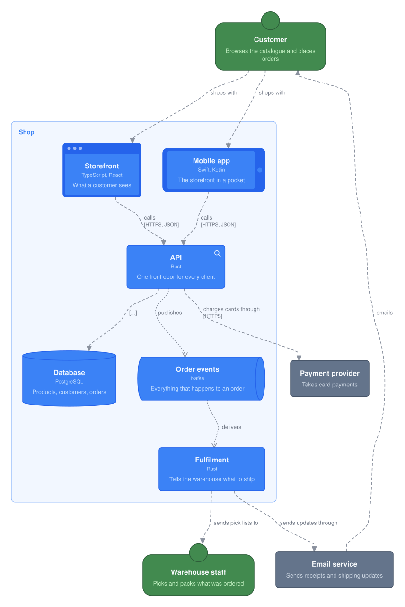

# rustc4

Architecture diagrams as code, in the [C4](https://c4model.com) style: describe
a system once, as a model, and get every diagram of it from that. It reads the
[LikeC4](https://likec4.dev) language and does what LikeC4 does (an
interactive viewer, images, a static site), with everything that matters
written once, in Rust, and compiled to each place it runs.

[](https://github.com/dmashuda/rustc4/actions/workflows/ci.yml)

> **Status: early.** The language, the command line and the `Diagram` format
> may still change between releases.
> rustc4 is an independent project, not affiliated with LikeC4; it reads the
> same language, less [what is not there yet](#the-language).



```
specification {
  element actor { style { shape person; color green } }
  element system
  element service
}

model {
  customer = actor 'Customer'
  shop = system 'Shop' {
    web = service 'Storefront' 'What a customer sees' 'React' { style { shape browser } }
    api = service 'API' 'One front door' 'Rust'
    web -> api 'calls' { technology 'HTTPS' }
  }
  customer -> shop.web 'shops with'
}

views {
  view index { include * }          // customer -> shop
  view shop of shop { include * }   // inside the shop, and who uses it
}
```

## Installing it

`rustc4` is one command with nothing to install beside it. Take it from a
[release](https://github.com/dmashuda/rustc4/releases) (Linux x86_64 and
aarch64, macOS arm64, Windows x86_64) and put it on your `PATH`:

```bash
tar -xzf rustc4-v0.3.0-linux-x86_64.tar.gz
cp rustc4-v0.3.0-linux-x86_64/rustc4 ~/.local/bin/
```

On Windows it is a `.zip` holding `rustc4.exe`:

```powershell
Expand-Archive rustc4-v0.3.0-windows-x86_64.zip
```

Each archive carries a signed attestation of where it was built. To check
that a download is the one this repository's release workflow made, from
the commit it says:

```bash
gh attestation verify rustc4-v0.3.0-linux-x86_64.tar.gz --repo dmashuda/rustc4
```

### Or building it

Everything is built by Bazel. Install
[Bazelisk](https://github.com/bazelbuild/bazelisk) as `bazel`; the Rust,
C++ and Node toolchains are downloaded by the build, so on Linux nothing
else needs installing, and on macOS only Xcode. The first build fetches and
compiles those toolchains and takes a while.

```bash
git clone https://github.com/dmashuda/rustc4 && cd rustc4
bazel build --config=release //cli
cp bazel-bin/cli/cli ~/.local/bin/rustc4
```

The playground (the viewer with an editor beside it) is not in a release,
and is started from the same checkout:

```bash
bazel run //apps/web:serve   # on http://localhost:8080
```

[CONTRIBUTING.md](CONTRIBUTING.md) has the rest: the Windows build, the
tests, how the code is laid out.

## Using it

```bash
rustc4 check examples/shop.c4    # report problems in a model
rustc4 views examples/shop.c4    # list its views
rustc4 export svg examples/shop.c4 -o out      # every view as an image
rustc4 export png examples/shop.c4 -o out --view shop --scale 2
rustc4 build examples/shop.c4 -o dist  # a static site: viewer + model + SVGs
rustc4 serve examples/shop.c4    # the same site on http://127.0.0.1:8080, following the file
rustc4 --help
```

[`examples/`](examples) in this repository holds separate models to try:
`shop.c4`, `bigbank.c4`, `delivery/`, which shows icons, sizes, stacks,
`where`, `global` and a legend, and `library/`, which shows the ways of
writing a relationship and what a view can say of one. Give one, as above.
(Given all of `examples`, they are read as one model, which is what a
directory means, and what more than one defines is reported.)

The one binary has the web viewer inside it: `rustc4 build` needs nothing
else to write a site, and any file server can host the result.

`rustc4 serve <path>...` is that site without writing it: the viewer on
`http://127.0.0.1:8080` (`--port` for another), showing the files as they
are. Save one from whatever editor you use and the page redraws, on the view
it was on; the terminal says what is wrong with what was saved.

A diagram has a legend over it: a sample of each shape and line whose
kind has a `notation` in the specification
(`element service { notation 'A service we run' }`), with what it says. A
view showing nothing with a notation has none. `--no-legend` leaves it out
of what `export` and `build` write; in the viewer the **Legend** button
hides it, and an export from there has it if it is showing.

`export` also writes `json`: the finished `Diagram`, every position and
color in it, for drawing with something of your own.

In the viewer: click a box or a line to see what it is and what it connects
to, double-click a box with a magnifying glass (or click the glass) to go to
the closer view of it, drag to move, pinch or ctrl-scroll to zoom. The address
bar follows the view, so a link opens on it. The playground has the source
beside the diagram and redraws as you type.

An icon's SVG file, and the file of a `descriptionFile`, are read along
with the sources that name them, and go into a bundle and a site with them. An icon from a URL is fetched by whatever
shows the diagram (a browser), so a PNG, which nothing
fetches for, is drawn without it, and says so.

## One model from many repositories

Keep each system's `.c4` files in its own repository, and read them all as
one model. Every command takes several paths, so with the repositories
checked out side by side:

```bash
rustc4 check  repos/*/architecture              # one model, checked as a whole
rustc4 bundle repos/*/architecture -o org.json  # ...gathered into one file
rustc4 build  org.json -o site                  # ...and a site of all of it
```

A bundle is the sources in one file; every command reads one wherever it
reads a directory. What makes the pieces fit:

- **Names are global.** `payments.api -> ledger.api` in one repository means
  the `ledger.api` another defines. Two repositories defining the same
  element is an error naming both files; adding to another's element is
  `extend ledger { ... }`.
- **Specifications may repeat.** Each repository can carry the element kinds
  it is checked against; the same kind specified the same way twice is fine,
  two that disagree is an error.
- **Everything remembers where it was written**, file and line, so from any
  box there is a way back to the repository that owns it.
- **View ids are global too**, so only one place should define `index`.

Every element with something inside it can be gone into, whether or not
anyone wrote a view of it: the landscape shows the top level, a click on a
system shows its services, a click on a service its components. Selecting a
box fades everything it is not connected to, which is what makes a crowded
view readable.

A hundred services side by side at the top level lay out in milliseconds,
but no drawing of a hundred boxes and their lines is easy to read. Group them
(`payments = domain { ledger = service ... }`): the landscape then shows a
dozen domains, each a click away from its services.

## For language models: MCP

`rustc4 mcp <path>...` serves the model over the
[Model Context Protocol](https://modelcontextprotocol.io) on stdio, so an
assistant can ask what exists and what depends on what instead of guessing.
It re-reads the files when they change.

```bash
claude mcp add architecture -- /path/to/rustc4 mcp /path/to/org.json
```

| Tool | Answers |
| --- | --- |
| `overview` | What is in the model: counts, kinds, the top level |
| `search` | "What handles refunds?" Elements by name, description, technology, tag; relationships by what they say |
| `element` | One element in full: what it is, the file it is written in, what it contains, uses and is used by |
| `neighbors` | Dependencies out to several steps, either way: "what breaks if this changes?" |
| `path` | "How does the mobile app reach the ledger?" |
| `views`, `view` | A diagram as text: its boxes, nested, and its lines |

Answers are short text that names every element in full, so one answer leads
to the next question. The same questions work at the command line:
`rustc4 query org.json -- used-by ledger.api 3`.

## The language

The LikeC4 dialect, most of it:

| | |
| --- | --- |
| `specification` | `element` kinds with `style` and tags, `relationship` kinds with tags and a `title`, `description` and `technology` for every relationship of the kind, `tag`, `color name #hex` or `rgb(r, g, b)`; `notation 'what this kind means'` on a kind, for the legend (a view can say otherwise: `style a { notation '…' }`, `include a with { notation '…' }`) |
| `model` | elements (`name = kind 'Title'` or `kind name 'Title'`), nested to any depth; `title`, `description`, `summary` (what the box says, if it should differ from the description), `technology`, `#tags`, `link`, `metadata`, `style`; relationships `a -> b 'title' 'description' 'technology'`, both ways `a <-> b`, `-> b` from inside an element, `a -[kind]-> b` (or `a .kind b`), with `line`, `color`, `head`, `tail` (`normal`, `open`, `vee`, `crow`, `diamond`, `dot` and the hollow `o…` ones) and `link`s; `descriptionFile ./docs/a.md` for a description kept in a `.md` or `.txt` file beside the source; `extend a.b { }` for more children, tags, metadata and links, `extend a -> b 'title' { }` for a relationship's; strings in `'''three quotes'''` for text with quotes of its own; `metadata` values as lists (`regions ['us', 'eu']`) |
| `views` | `view id of element`, `view b extends a`, `title`, `description`, `include` / `exclude` of `*`, `a.b`, `a.*`, `a.**`, `a._`, `element.kind = k`, `element.tag = #t`, `-> a`, `a ->`, `-> a ->`, `a -> b`, and those of one kind `a -[kind]-> b`; `where` after any of them (`include * where kind is service and tag is not #old`, and after a relationship `-> a where source.tag is #x`: `kind`, `tag`, `metadata.key`, `is` / `is not`, `and`, `or`, `not`, brackets); `include a with { color red }`, and for the lines `include a -> b with { color red; line solid; title '…' }`; `style targets { }`; `autoLayout TopBottom / LeftRight / BottomTop / RightLeft`, then if you like how far apart rows and boxes are (`autoLayout LeftRight 120 110`); `rank same { a, b }` to put boxes on one row, `rank min` / `max` on the first or last, `rank source` / `sink` with that row to themselves; `global style name` and `global predicate name`; `dynamic view id { a -> b 'title'; a <- b; a -> b -> c; parallel { } }` with `notes`, drawn as numbered steps; `variant sequence` draws them as a sequence diagram |
| Styles | shapes `rectangle person browser mobile cylinder storage queue`; the theme colors or your own; `border` (`none` for no border), `opacity`; `size`, `padding` and `textSize` from `xsmall` to `xlarge`; `multiple true` for a stack; `icon` from a URL or an SVG file beside the source (`icon ./icons/db.svg`), with `iconSize` and `iconPosition left / right / top / bottom` |
| `global` | `style name targets { }`, `styleGroup name { }`, `predicateGroup name { }`: rules with a name, for any view to ask for |
| `import` | `import { a } from 'project'` is checked and otherwise unneeded: names are already global |

Sources may be split over any number of `.c4` (or `.likec4`) files; they are
read as one model. A mistake is reported with its file, line and column, and
everything that could be understood is still drawn.

Not there yet, each reported as a warning ("not supported yet") and never
silently ignored, with the rest of the model still drawn:

- deployment models and views, and `diff` blocks
- `group` in a view (what it includes is shown, without the frame),
  `ortho` routing, manual layout
- in a dynamic view, `opt`, `loop`, `alt` and `try` (their steps are shown
  as ordinary steps, in order)
- the shapes `component`, `document`, `bucket` and `agent` (rectangles),
  see-through colors, `sizing fixed`
- the icons LikeC4 bundles (`tech:rust`, `aws:lambda`), icons from files
  that are not SVG and from `@/` aliases
- `multiple` and `navigateTo` on a relationship, links on a kind or a
  view, `order`

Markdown in a description is shown as it is written.

## What is next

- **iOS and Android.** The viewer is written to be shared with both.
- **A bundled font for PNG export**, so the CLI's PNGs do not depend on what
  the machine has installed (they use Helvetica, Arial or the nearest
  sans-serif found).
- A language server.

## Contributing

Issues and pull requests are welcome. [CONTRIBUTING.md](CONTRIBUTING.md)
says how to build and test a change, how the code is put together, and how
a release is made.

## License

[MIT](LICENSE).
